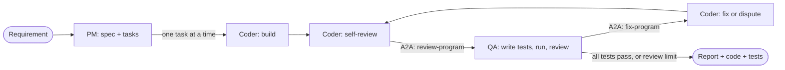

# Autonomous Multi-Agent Development Team

[](https://github.com/mikerukaj/multi-agent-dev-team-full/actions/workflows/ci.yml)
[](LICENSE)


Three Claude agents turn a plain-English software requirement into tested, working
Python, with no human input after the first prompt. A **Product Manager** plans the work,
a **Coder** builds it and reviews its own code, and a **QA & Debugger** writes real pytest
tests, runs them in a locked-down sandbox and sends back a fix list until the tests pass.
Underneath: a LangGraph state machine that always terminates, agent-to-agent messaging
over A2A, file access through an MCP server, retries and circuit breakers on every
outside call, per-call cost tracking, and a 550-test offline suite.

<a href="docs/ARCHITECTURE.md"></a>

<sub>The replay above is the offline demo (`python -m demo`: scripted model replies,
simulated sandbox, no API key). A real sample run will be published from the benchmark
refresh.</sub>

## What it does

```text
$ python -m orchestration.team "A command-line tool that converts temperatures between Celsius and Fahrenheit" --budget 2
```

| In | Out |
|----|-----|
| One sentence of requirement | A specification with acceptance criteria and up to 8 ordered tasks |
| | The program, written and run task by task in a sandbox: `workspace/<run_id>/` |
| | QA's pytest suite, written from the spec, not from the code: `workspace/<run_id>/tests/` |
| | QA's report: every review, every finding and how it was resolved: `.qa/report.md` |
| | A cost report per agent, an event log, and a checkpoint to resume from |

## Highlights

- **Real tests, judged in code.** QA's tests run in a Docker sandbox with no network, and
  pass or fail comes from JUnit XML checked against pytest's exit code. The model can't
  talk its way past a failing test ([ARCHITECTURE.md](docs/ARCHITECTURE.md#qa--debugger)).
- **A loop that always ends.** One router allows a fix round only while reviews remain
  (5 by default); every failure path goes to a final report
  ([`orchestration/team.py`](orchestration/team.py),
  [`tests/test_team_loop.py`](tests/test_team_loop.py)).
- **Never crashes on a failing dependency.** Every model, MCP, sandbox and memory call is
  retried behind a circuit breaker and degrades to a cached answer or a resumable end.
  Every node is tested with every dependency failing
  ([`tests/test_never_crashes.py`](tests/test_never_crashes.py),
  [RELIABILITY.md](docs/RELIABILITY.md)).
- **Cost you can see per call.** Every model call is priced and tagged with its agent and
  operation; `python -m cost.audit` ranks the expensive ones and a budget caps a run
  ([OBSERVABILITY.md](docs/OBSERVABILITY.md#per-interaction-cost),
  [PERFORMANCE.md](docs/PERFORMANCE.md)).
- **Secrets stay secret.** Generated code runs with no network and no environment
  secrets, and every log, report and trace is redacted; a test plants secrets in a full
  run and checks every output ([SECURITY.md](docs/SECURITY.md),
  [`tests/test_secret_sweep.py`](tests/test_secret_sweep.py)).
- **Checked on every push.** CI runs ruff, the offline suite with an 85% coverage gate,
  and an API-docs freshness check ([`.github/workflows/ci.yml`](.github/workflows/ci.yml),
  [TESTING.md](docs/TESTING.md)).

## How it works



- **Product Manager** (Claude Sonnet 5.5): writes the specification and at most 8
  ordered tasks, each with checkable acceptance criteria. An oversized plan is merged,
  and the merge is checked in code.
- **Coder** (Claude Haiku 5.5): builds each task in a ReAct loop over `read_file`,
  `write_file` (through MCP) and `exec_python` (in the sandbox), critiques its own code
  before every handoff, and answers every QA finding by fixing it or disputing it with a
  reason from the spec.
- **QA & Debugger** (Claude Haiku 5.5): writes pytest tests from the spec (seeing only the
  code's public interface at first), runs them in the sandbox, reviews the code, and
  decides in code whether the program is complete or needs another fix round.

All three are nodes of one LangGraph `StateGraph` over a typed state. The Coder and QA
never call each other; they exchange A2A messages through a broker. Full detail, and why
LangGraph: [docs/ARCHITECTURE.md](docs/ARCHITECTURE.md).

## Quick start (10 minutes)

These steps take a software engineer who has never seen the project from a clone to a
finished live run. Times are for a laptop on a normal connection. Steps 1–5 cost
nothing; step 6 makes paid model calls under a $2.00 cap.

### 1. Prerequisites (1 minute)

- **Python 3.12** (`python3.12 --version`)
- **Docker**, runnable by your user (`docker version` shows a Server section). Generated
  code and tests only ever run in a locked-down Docker sandbox.
- **An Anthropic API key**, for step 6 only
- Linux is verified. macOS (with Docker Desktop) gets the same commands, with the
  differences noted, but hasn't been verified yet. On Windows, use WSL 2.

### 2. Clone and install (3 minutes)

```bash
git clone https://github.com/mikerukaj/multi-agent-dev-team-full.git
cd multi-agent-dev-team-full
python3.12 -m venv .venv
source .venv/bin/activate
pip install -r requirements.txt        # requirements-dev.txt adds the test and doc tools
```

While pip runs, build the sandbox image in a second terminal. Otherwise the first live
run builds it (about a minute; the only step with network access, and it runs no
generated code):

```bash
docker build -t multi-agent-sandbox:py3.12-pytest9.1.1 sandbox/
```

### 3. Configure (1 minute)

```bash
cp .env.example .env
```

Then open `.env` and set your key. It's the only required setting:

| Variable | Needed for | Meaning |
|----------|-----------|---------|
| `ANTHROPIC_API_KEY` | live runs | Your Anthropic API key. Read at run time, never logged or committed |
| `RUN_BUDGET_USD` | optional | A spending cap for every run (`--budget` sets it for one run) |
| `TEAM_MAX_ITERATIONS` | optional | Most QA reviews per run, 1–10 (default 5) |
| `LANGSMITH_TRACING`, `LANGSMITH_API_KEY` | optional | Send one LangSmith trace per run |
| `HOST_UID`, `HOST_GID`, `DOCKER_GID` | Docker Compose only | `id -u`, `id -g`, and the Docker socket's group: `stat -c %g /var/run/docker.sock` on Linux, `stat -f %g /var/run/docker.sock` on macOS |

Every other setting (models, effort, timeouts, retries, caching) is in
[docs/CONFIGURATION.md](docs/CONFIGURATION.md).

### 4. Check the environment (10 seconds)

```bash
python -m orchestration.health
```

Every line should start with `ok` (or `info` for optional items). Any line that isn't
ok ends with what to do about it, for example the `docker build` command above.

### 5. Watch it work offline (15 seconds, free)

```bash
python -m demo
```

This runs the whole team on a temperature converter with scripted model replies and a
simulated sandbox. It needs no key, no Docker and no network. QA's tests catch a real
bug (`-40F` loses its sign), the Coder fixes it, and the second review passes. The
output says it's simulated; step 6 is the real thing.

### 6. Run the team live (3–5 minutes, under $2.00)

```bash
python -m orchestration.team "A command-line tool that converts temperatures between Celsius and Fahrenheit" --budget 2
```

Progress goes to stderr as the agents work:

```text
[pm] "Temperature converter": 3 tasks
[handoff] T1 (high) Convert a value between units
[step 1] write_file converter.py
[coder] T1 completed in 3 steps (41.2 s)
...
[reflect] before QA #1: 3 critique items, revision completed
[a2a] coder → qa-debugger review-program task 3f2a1b9c… completed (48.2 s)
[qa] #1: 9 passed, 2 failed, 0 errors → 3 blocking, 1 advisory
[a2a] qa-debugger → coder fix-program task 9c1e0d4a… completed (71.0 s)
[fix] #1: completed (7 steps), answered 3 of 3 (1 disputed)
[reflect] before QA #2: 2 critique items, revision completed
[qa] #2: 11 passed, 0 failed, 0 errors → complete
[finish] completed (complete) · report: .qa/report.md
```

If the run stops early (rate limit, outage, budget), it ends with a resumable status.
Continue it with `python -m orchestration.team --resume <run_id>`.

### 7. Read the results (1 minute)

| Where | What |
|-------|------|
| stdout | The final run state as JSON: spec, tasks, every QA iteration, cost (secrets redacted) |
| `workspace/<run_id>/` | The generated program and QA's tests (`tests/`) |
| `workspace/<run_id>/.qa/report.md` | QA's final report: result, iterations, unresolved findings |
| `docs/cost_reports/<run_id>.json` | Tokens and cost per agent |
| `workspace/.runs/<run_id>/events.jsonl` | Every event. `python -m cost.audit workspace/.runs/<run_id>` ranks what each agent operation cost |

## Run with Docker Compose

The whole pipeline, with a Chroma server for the Coder's memory, in one command. Set
`ANTHROPIC_API_KEY`, `HOST_UID=$(id -u)`, `HOST_GID=$(id -g)` and the Docker socket's
group in `.env` (`DOCKER_GID=$(stat -c %g /var/run/docker.sock)` on Linux,
`stat -f %g` on macOS), then:

```bash
docker compose up --build --abort-on-container-exit --exit-code-from agent
```

It runs `TEAM_REQUIREMENT` (a temperature converter by default) once and exits with the
run's exit code. Details, the image's stages and the Docker-socket trust exception:
[docs/DEPLOYMENT.md](docs/DEPLOYMENT.md).

## Results

| Evidence | Result |
|----------|--------|
| [Benchmark](docs/BENCHMARK.md): 10 fixed requirements, all three agents on Sonnet 5.5 ([results](benchmarks/results/20261020T053121Z-baseline.json)) | **9/10 pass**, 3/3 failing first drafts fixed, median 223 s per item |
| The same, before a QA defect was fixed ([results](benchmarks/results/20261020T043138Z-before-qa-fix.json), [what happened](docs/REFLECTION.md#a-bug-and-how-it-was-resolved)) | 4/10: QA gave up after one rejected reply |
| Benchmark at the current defaults (Coder and QA on Haiku 5.5) | Not yet measured: waiting on a valid API key |
| [End-to-end tasks](docs/E2E_RESULTS.md) and [performance audit](docs/PERFORMANCE.md) | Not yet run: waiting on a valid API key |
| Offline suite ([TESTING.md](docs/TESTING.md)) | 550+ tests, 96% statement coverage, about 2.5 minutes, no paid calls |

## Documentation

| Document | What's in it |
|----------|--------------|
| [ARCHITECTURE.md](docs/ARCHITECTURE.md) | Data flow, each agent's role and decision logic, the graph and why LangGraph, A2A and MCP, design trade-offs |
| [RELIABILITY.md](docs/RELIABILITY.md) | Retries, circuit breakers, degradation, output validation, resuming a run, exit codes |
| [OBSERVABILITY.md](docs/OBSERVABILITY.md) | Events, run summary, LangSmith tracing, cost reports, budgets, prompt caching, per-interaction cost |
| [SECURITY.md](docs/SECURITY.md) | The sandbox, file-access rules, secret redaction, the Docker-socket trust exception |
| [CONFIGURATION.md](docs/CONFIGURATION.md) | Every command-line option and environment variable |
| [DEPLOYMENT.md](docs/DEPLOYMENT.md) | Docker Compose, the image, running the tests in the image |
| [TESTING.md](docs/TESTING.md) | Test layers, what each module covers, style and documentation checks, CI |
| [BENCHMARK.md](docs/BENCHMARK.md), [E2E_RESULTS.md](docs/E2E_RESULTS.md), [PERFORMANCE.md](docs/PERFORMANCE.md) | Measured results and how they were measured |
| [REFLECTION.md](docs/REFLECTION.md) | The main design decisions, a bug and its fix, what I'd do differently |
| [DEMO_GUIDE.md](docs/DEMO_GUIDE.md) | A timed script for presenting the project live |
| [API reference](docs/api/index.html) | Every public module, class and function (generated with pdoc). It cites internal requirement IDs; see [TESTING.md](docs/TESTING.md#requirement-ids) |
| [CONTRIBUTING.md](CONTRIBUTING.md) | Setup, the checks, regenerating generated files, commit style |

## Where to look

- [`orchestration/team.py`](orchestration/team.py): the team graph, its routers (the
  `route_after_*` functions) and why every run ends.
- [`agents/llm.py`](agents/llm.py): `ModelCaller`, the single path every model call
  takes: retries, circuit breaker, degradation, validation, caching, cost and tracing.
- [`agents/qa_agent.py`](agents/qa_agent.py): QA as a pipeline. `normalise_findings` and
  `verdict_for` decide severity and the verdict in code.
- [`agents/coder_agent.py`](agents/coder_agent.py): the Coder's ReAct loop as a small
  LangGraph graph, and self-reflection.
- [`messaging/broker.py`](messaging/broker.py): the asyncio A2A broker that carries
  every Coder ⇄ QA exchange.
- [`resilience/circuit.py`](resilience/circuit.py): the circuit breaker and the guard
  that wraps every outside call.
- [`tools/mcp_server.py`](tools/mcp_server.py): the MCP file server that enforces the
  workspace and "tests belong to QA" rules.
- [`demo/__main__.py`](demo/__main__.py): the offline demo, built from the real agents
  with only the model and sandbox swapped out.

## Project layout

```text
agents/          The PM, Coder and QA agents, the shared model-call path, memory
orchestration/   The team graph and its typed state, checkpoints, health check, run services
messaging/       A2A 1.0 types, the asyncio broker, the agent endpoints
tools/           The MCP file server and client, the sandboxed code and test runners
resilience/      Failure classification, retries, circuit breakers, the response cache
observability/   Events, run summary, LangSmith tracing, secret redaction
cost/            Price table, per-agent ledger and budget, cost reports, the cost audit
benchmarks/      The fixed benchmark, the end-to-end tasks, the runner and its results
demo/            The offline demo (scripted model, simulated sandbox)
sandbox/         The sandbox image: Python 3.12 and pytest, pinned
scripts/         The check, test, API-docs, demo-recording and sample-export scripts
tests/           Unit tests, plus integration/ and e2e/ layers, fakes and fixtures
docs/            Topic documents, the API reference, the demo recording
.github/         The CI workflow
```

## Known limitations

- **Verified on Linux only.** macOS (with Docker Desktop) gets the same commands, with
  the differences noted, but hasn't been verified yet. Windows needs WSL 2.
- **The current model mix isn't benchmarked yet.** The 9/10 result is for all three
  agents on Sonnet 5.5; the Coder and QA now default to Haiku 5.5.
- **Small evidence base.** The benchmark has 10 items, and live runs aren't
  deterministic: the same requirement can take a different number of fix rounds.
- **QA is strict about traceability.** It refuses tests whose criteria aren't copied from
  the spec, which caused the one benchmark failure.
- **Docker-socket trust under Compose.** The agent container controls the host's Docker
  engine, which is equivalent to root on the host ([SECURITY.md](docs/SECURITY.md)).
- **Requires Docker for live runs.** Generated code never runs outside the sandbox, so
  without Docker only the offline demo and tests work.

## License

[MIT](LICENSE). Built during the *Build Autonomous Multi-Agent Systems* course.
