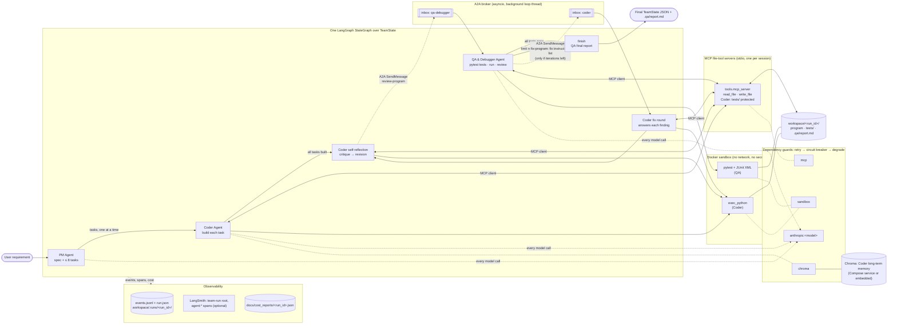

# Architecture

## Overview

A requirement in plain English goes in; tested, working Python comes out. Three agents
built on Claude share the work: a **Product Manager** turns the requirement into a
specification and at most eight ordered tasks, a **Coder** builds each task with file and
sandbox tools and reviews its own code before every handoff, and a **QA & Debugger**
writes real pytest tests from the specification, runs them in a locked-down sandbox,
reviews the code and sends back a fix list. The agents are nodes of one LangGraph
`StateGraph` over a typed shared state (`TeamState`). The graph decides what runs next
and guarantees the run ends. The Coder and QA never call each other directly: every
exchange between them is an A2A message through an in-process broker, and every file
they touch goes through an MCP server that enforces the file rules.

## Data flow



Every call to an outside service (the model per model ID, the MCP server, the sandbox,
Chroma) goes through its own **guard**: retries, a circuit breaker, then a degraded
answer or a clean, resumable end ([RELIABILITY.md](RELIABILITY.md)). Every node reports
events, spans and cost ([OBSERVABILITY.md](OBSERVABILITY.md)), and every run, however it
ends, leaves a final record, a checkpoint it can resume from, and a cost report.

| Who | Reads | Writes |
|-----|-------|--------|
| Coder (build, revision, fix) | anything in the workspace through MCP | source files through MCP. `tests/` and `.qa/` are refused |
| QA | the interface (iteration 1, before tests), then the full source and tests through MCP | `tests/**`, `.qa/report.md` through MCP |
| Sandbox runs | the workspace (`tests/` read-only) | the workspace (Coder `exec_python`), `/qa-out` (pytest) |

## Agents

### Product Manager

**Role:** turn the requirement into a technical specification (name, description,
acceptance criteria, assumptions) and an ordered list of tasks, each with its own
checkable acceptance criteria and a priority. Code: `agents/pm_agent.py`, on Claude
Sonnet 5.5 at `high` effort, because a bad plan wastes every later call.

**Decision logic:**

- One structured-output call writes the spec. The reply is validated against its
  `TypedDict` before any field is read.
- It **rejects** a requirement only when it is empty, nonsense or not a request for
  software, never because it is large. A rejection ends the run `rejected`.
- If it plans more than **8 tasks**, it is asked once to merge them. The merge is checked
  in code (every criterion kept, in order); if that check fails, a deterministic merge
  of neighbouring tasks is used instead.
- The graph then hands the tasks to the Coder one at a time, in order. A failed task
  ends the run, keeping the code written so far.

### Coder

**Role:** build each task as clean, modular Python, review its own code before QA sees
it, and fix or dispute what QA reports. Code: `agents/coder_agent.py`, on Claude Haiku
5.5 at `medium` effort.

**Decision logic:**

- Each task, revision or fix round is a **ReAct loop**: the model chooses among
  `read_file`, `write_file` (both over MCP) and `exec_python` (in the sandbox), sees the
  real results, and stops when it says it is done or reaches its step cap (10 by
  default). The code, the files written and the execution result reported are read
  back from disk and real runs, never taken from the model's claims.
- **Self-reflection** before every handoff to QA (after the build and after each fix
  round), in `CoderAgent.reflect`: first a **critique call** with no tools, which sees
  the brief and every non-test source file and must list at least one potential bug or
  edge case, numbered `C1…Cn` (an empty list is retried once); then a **revision
  session**, a normal ReAct run that must answer every `C…` item by changing the code or
  saying why not, and then run the program. `CODER_REFLECTION_ROUNDS` (1–3, default 1)
  sets how many rounds run before each handoff.
- In a **fix round**, it must answer every blocking finding: `fixed`, or `disputed` with
  a reason from the specification. QA then decides each dispute.
- Its history is append-only and its system prompt and tool list never change, so the
  prompt cache keeps working; long-term memories from Chroma arrive as new messages.

### QA & Debugger

**Role:** decide, from real test runs, whether the program meets the specification, and
if not, say exactly what to fix. Code: `agents/qa_agent.py`, on Claude Haiku 5.5 at
`high` effort.

**Decision logic:**

`agents/qa_agent.py` is a fixed pipeline, not an open-ended agent loop, so each
iteration makes two to four model calls and all of its checks happen in code. Each
iteration goes like this:

1. **Write tests from the specification only.** In iteration 1, QA sees each module's
   public interface (signatures and docstrings, extracted with `ast`, with no function
   bodies), so expected values come from the spec rather than from whatever the code
   does. Every test file lists the acceptance criteria it checks. Criteria that are not
   copied from the spec, and paths outside `tests/`, are refused.

   Every QA reply is checked in full before anything is written. A reply that is
   refused, isn't valid JSON, or is cut off at the output limit gets one corrected
   attempt: QA is asked again with the reason. A second bad reply ends the iteration as
   before.
2. **Run them for real.** pytest runs in the same no-network, read-only sandbox image as
   the Coder's code, with `tests/` mounted read-only. `-c /dev/null` and `--confcutdir`
   stop a stray `pytest.ini` or `conftest.py` from changing the run, and results come back
   as JUnit XML. A suite that doesn't load is repaired by QA (up to `QA_REPAIR_ATTEMPTS`
   times) and never counts as passing. A timeout counts as a failure.
3. **Review and diagnose.** QA reads the full code, the tests and the results, and
   reports findings. Code then enforces the rules:
   - every failing test gets a finding;
   - failing tests and bugs are always blocking;
   - a style finding blocks only if it cites one of the project's MUST coding rules
     (`CONSTITUTION_RULES` in `agents/qa_agent.py`);
   - code that special-cases test inputs is a blocking bug.
4. **Later iterations.** QA restores any test file changed outside QA and reports the
   change. It decides the Coder's disputes against the spec, keeping or correcting the
   test. Earlier findings that were not reported again are marked `fixed`.

The verdict is `complete` only when the suite loaded, every test passed, and no open
blocking finding remains.

## Orchestration

The run is one LangGraph `StateGraph` (`orchestration/team.py`) over `TeamState`, a
`TypedDict` that round-trips through JSON unchanged. The nodes are `pm`, `consolidate`,
`dispatch`, `coder`, `reflect`, `qa`, `fix` and `finish`. Plain routing functions decide
the next node from the state: an oversized plan goes to `consolidate`; tasks go one at a
time from `dispatch` to `coder`; after the last task the Coder reflects and hands over to
QA; QA's verdict either finishes the run or starts a fix round.

**A run, step by step:**

1. **Plan.** The PM writes the spec and tasks. The PM side hands one task at a time to
   the Coder on the `handoff` state key. If the PM plans more than 8 tasks, it is asked
   once to merge them, and the merge is checked in code with a deterministic fallback.
   A failed task ends the run, with the code written so far kept.
2. **Build, then reflect.** After the last task, the Coder critiques its own program
   (a tool-less call listing at least one potential bug or edge case). It then runs a
   revision session that must answer every item.
3. **Review over A2A.** The Coder sends a `review-program` message to `qa-debugger`. QA
   tests and reviews the program and replies with its verdict and its findings, which are
   the fix instruction list.
4. **Fix over A2A, then loop.** If QA's verdict is `fix_needed` and iterations remain, QA
   sends a `fix-program` message carrying the fix instruction list to `coder`. The Coder
   fixes or disputes each finding, reflects again, and hands the program back for the
   next review.
5. **Finish.** The run ends when QA says `complete`, when the iteration limit is reached,
   or when an agent fails. The team then asks QA (`final-report`) for a final report,
   which lists every unresolved finding and is written to `workspace/<run_id>/.qa/report.md`.

**The loop always ends.** `route_after_qa` starts a fix round only while the run is
going, QA said `fix_needed`, and fewer than `max_iterations` reviews have run (5 by
default, 1–10). Every failure path routes to `finish`, and each Coder session has a step
cap. Safeguards in detail:

- **A hard iteration limit.** `TEAM_MAX_ITERATIONS` (or `--max-iterations`) sets the most
  QA reviews per run: 5 by default, from 1 to 10. The router never starts a fix round
  after the last allowed review, so a run can't loop indefinitely.
- **A final report instead of more loops.** When the limit is reached, the run ends
  `failed` with `end_reason: iteration_limit`. QA's report lists each unresolved finding
  with its fix instruction.
- **Clear end reasons:**
  - `complete`
  - `iteration_limit`
  - `task_failed` (a build task)
  - `reflection_failed`
  - `coder_failed` (a fix round)
  - `qa_failed`
  - `a2a_failed` (a broker or protocol failure, or a timeout)
  - `rejected`, `pm_error`
  - `dependency_unavailable` (a model service, MCP server, sandbox or Chroma failed past
    its retries, or its circuit is open)
  - `budget_exceeded` (the run's spend reached its budget)
  - `interrupted` (SIGINT or SIGTERM)
- **Step caps don't stop the loop.** A fix round or revision that reaches the Coder's
  step cap still goes to QA as it stands. Unanswered findings stay open.
- **Tests belong to QA.** The Coder's file writes under `tests/` are refused by the MCP
  server, the Coder's own code runs see `tests/` read-only, and QA restores anything
  changed anyway.

**Why LangGraph.** The run needs explicit, typed state, routing that can be read and
tested in one place, and a loop with a provable bound. LangGraph's core graph API
(`StateGraph`, `START`, `END`) gives exactly that, with little code and no hidden
behavior. The project uses nothing else from it:

- **Not a hand-written loop:** the routing rules would end up scattered through `if`
  statements, and stage-by-stage checkpointing and observation would have to be built
  around them. With a graph, each node is wrapped once for checkpoints, events and spans.
- **Not a full agent framework or LangGraph's prebuilt agents:** they choose prompts,
  tool loops and retries on your behalf. Here those choices are the point: one
  model-call path with its own retries, validation and cost tracking, and QA as a fixed
  pipeline.
- **Not LangGraph checkpointers:** the project writes its own atomic JSON checkpoints,
  which can be redacted, versioned and resumed with a run lock.

## What a run returns (`TeamState`)

| Field | Meaning |
|-------|---------|
| `requirement`, `spec`, `tasks` | The text you gave, the PM's specification, and its ordered tasks |
| `task_progress`, `code_output` | Per-task status, and each file each task wrote |
| `consolidation` | Set when the PM planned more than 8 tasks |
| `iterations` | One entry per QA review: the reflection before it, the test run, the findings (fix instruction list), disputes, test changes, the verdict, and the Coder's fix round after it |
| `qa_report` | QA's final report: result, end reason, iterations used, final test counts, unresolved and advisory findings, report path |
| `a2a_log` | Every A2A exchange between the Coder and QA (and the team's report request) |
| `test_suite` | QA's own copy of its tests (path → content) |
| `max_iterations` | The iteration limit for this run |
| `status`, `end_reason`, `error` | `completed`, `failed`, `rejected` or `error`, the detailed reason, and the message |
| `usage`, `duration_seconds` | Tokens used by all agents (including cache reads and writes), and the run's wall-clock time |
| `run_id`, `workspace` | The run's ID and the folder holding its code, tests and `.qa/report.md` |
| `agent_usage`, `cost_usd`, `budget_usd` | Per-agent calls, tokens, cost, retries, errors, tool calls and time; the run's total cost; its budget |
| `failure` | The structured `DependencyFailure` that ended the run, if one did |
| `resume_history`, `resume_from` | Every resume of the run (stage, budget change, files restored or removed) |
| `summary`, `events_lost` | The run summary over every attempt, and whether any event failed to be written |
| `trace_url`, `cost_report_path` | The LangSmith trace (when tracing is on) and the cost report |

## The Coder on its own

```bash
python -m agents.coder_agent "Write fizzbuzz.py that prints FizzBuzz for 1 to 15"
```

The standalone Coder builds the program, then reflects once (critique, then revision).
It takes the same `--max-steps` and `--timeout` options and prints `[step N]` progress
lines. Its JSON output is the revision's result, plus `first_draft` and the `reflection`
rounds. The exit code is 0 if the revision completed, 1 for any other outcome, and 2 for
usage errors.

## Messaging and tools

### Agent-to-agent communication (A2A)

The Coder and QA communicate with Google's **Agent2Agent (A2A) protocol, version 1.0**,
carried by an in-process **asyncio broker** (`messaging/`). Both use only the standard
library.

- **Why A2A:** a standard message, task and agent-card model. Either agent could later
  move to its own process or machine without changing what the messages contain.
- **The broker:** each agent has its own `asyncio.Queue` inbox and one worker that
  handles messages one at a time, in order. The agent's synchronous work runs in a thread
  pool so the loop stays free, and replies are matched to requests with futures. Every
  message is copied through JSON at the boundary, so the agents never share Python
  objects, and neither agent module imports the other.
- **A documented custom binding:** `urn:multi-agent-lab:a2a-binding:asyncio-broker:1.0`.
  A2A 1.0 allows custom transports. It covers `SendMessage`, `GetTask`, `ListTasks` and
  `CancelTask`, the A2A error codes (-32001 to -32009), and the `A2A-Version` check.
  Streaming, push notifications and extended cards are not supported, and both agent
  cards say so. There is no authentication: the trust boundary is the single local
  process.
- **Agent cards and skills:** `qa-debugger` offers `review-program` and `final-report`,
  and `coder` offers `fix-program`. The Coder's build tasks and self-reflection are its
  own work, so they don't go through the broker.
- **The record:** every exchange is in `a2a_log`, with sender, recipient, skill, task ID,
  each task state with a timestamp, and the outcome. All exchanges in a run share
  `contextId = run_id`, and each `fix-program` request names, in `referenceTaskIds`, the
  review it answers.
- **Timeouts:** a request with no answer within `A2A_REQUEST_TIMEOUT` seconds (default
  1800) is cancelled where possible, and the run ends with `a2a_failed`.

### MCP file tools

The two file tools, `read_file` and `write_file`, are served by a **Model Context
Protocol (MCP) server**, `tools/mcp_server.py`, built on the official Python SDK
(`mcp==2.3.0`). The Coder and QA agents are MCP clients: they discover the tools from
the server and every file read and write goes through it. `exec_python` is **not** offered
over MCP. It needs the run's sandbox image and time limit, so it stays in-process.

**Why MCP:**

- **A standard, discoverable tool interface.** The tool list and schemas come from the
  server at the start of each session, not from constants compiled into each agent.
- **Reusable by any MCP client.** The same server works for Claude Code, Claude Desktop
  or any other MCP client, so you can inspect or edit a run's workspace with the exact
  rules the agents follow.
- **Rules enforced outside the model.** The workspace confinement and the Coder's
  "tests are QA's" rule live in a separate process. The model can't argue with it, and
  a bug in an agent can't bypass it.
- **One place for the file rules.** Paths outside the workspace (absolute, `..`, or a
  link pointing out) are refused in one handler.

**How it is used:**

- **Low-level server over stdio.** The server publishes the existing strict tool schemas
  unchanged and returns the existing error texts, such as `File not found: x.py`. It
  checks arguments itself, because SDK v2 no longer does. A bad call returns an error
  result and the server keeps serving. stdio needs no ports and ends with its client.
- **One server per agent session, bound to one workspace.** The Coder's sessions start
  it with `--protect tests --protect .qa`, so a Coder write under `tests/` is refused
  with `Path is protected: … (only the QA Agent may change tests)`. QA's sessions have
  no protected paths.
- **No secrets.** The client gives the server process an environment with only `PATH`
  and `PYTHONIOENCODING`, and the server never reads `.env`.
- **No fallback.** If the server can't start, the session fails (`McpUnavailableError`)
  rather than quietly reading and writing files directly.

**Running it on its own:**

```bash
python -m tools.mcp_server --workspace workspace/<run_id> [--protect PREFIX]...
```

It exits with code 2 and a message on stderr if the workspace folder doesn't exist, or if
a `--protect` path leaves the workspace. To connect another MCP client, add this to that
client's server list (with absolute paths):

```json
{
  "mcpServers": {
    "file-tools": {
      "command": "/abs/path/to/.venv/bin/python",
      "args": ["-m", "tools.mcp_server", "--workspace", "/abs/path/to/workspace/demo"],
      "cwd": "/abs/path/to/multi-agent-dev-team-full"
    }
  }
}
```

Started this way, with no `--protect`, the server gives full read and write access to the
chosen workspace.

## Design trade-offs

- **Models by role, through the official `anthropic` SDK.** The PM uses Claude Sonnet 5.5
  with server-side refusal fallback; the Coder and QA use Claude Haiku 5.5, which makes
  most of a run's calls far cheaper. All three use adaptive thinking; the PM and QA run at
  `high` effort, the Coder at `medium`. [BENCHMARK.md](BENCHMARK.md) has the measured
  pass rate for each configuration.
- **One model-call path.** Retries, circuit breaking, degradation, caching markers,
  validation, cost and tracing are written once, in `ModelCaller`; the SDK's own retries
  are off so retries happen in one place.
- **LangSmith, used narrowly.** Only its `RunTree` and `Client` (with redaction hooks),
  with explicit parents, so nothing ambient leaks between threads; no wrappers and no
  LangChain imports.
- **`TypedDict` validation, not Pydantic.** The reply types sit next to the state types,
  and a test keeps them in step with the JSON schemas.
- **Checkpoints without LangGraph checkpointers.** The project's own atomic JSON files and
  a `flock` run lock, which the project's design rules allow and which can be redacted and
  versioned.
- **LangGraph for every loop.** The team graph and the Coder's own ReAct graph use only
  the core graph API, as the project's design rules require.
- **QA is a pipeline, not a second agent loop.** Running and parsing tests, setting
  severity, and deciding the verdict happen in code, so the model can't talk its way past
  a failing test.
- **Real tests, run for real.** pytest runs in the sandbox, and results come from JUnit
  XML checked against pytest's exit code, never from the model's reading of the code.
- **The graph keeps control, the agents stay decoupled.** The loop's routing (and its
  termination guarantee) lives in one router. All Coder ⇄ QA traffic crosses the A2A
  broker as copied JSON.
- **No SDK where the standard library suffices.** A2A is implemented from the 1.0 spec
  with `TypedDict`s and `asyncio`. `a2a-sdk` targets HTTP and gRPC transports this project
  doesn't use, and would add more packages.
- **The official MCP SDK where the protocol is the point.** `mcp==2.3.0`, using only its
  low-level server, stdio transport and `ClientSession`, as the project's dependency rules
  allow.
- **A typed shared state, no Pydantic.** Everything in `TeamState`, including the A2A
  request payloads, is a `TypedDict` that round-trips through JSON unchanged.
- **Append-only history.** Sonnet 5.5 rejects edited history, so a Coder session's system
  prompt and tool list never change, and memories arrive as new system messages.
- **Ground truth over claims.** Code, execution results and test results come from files
  on disk and real runs.
- **Minimal dependencies:** `anthropic`, `langgraph`, `chromadb`, `mcp`, `python-dotenv`,
  `langsmith`, plus `pysqlite3-binary` only for hosts with an old SQLite. `coverage` is a
  development-only dependency (`requirements-dev.txt`). pytest lives only inside the
  sandbox image, and the project's own tests use `unittest`.
